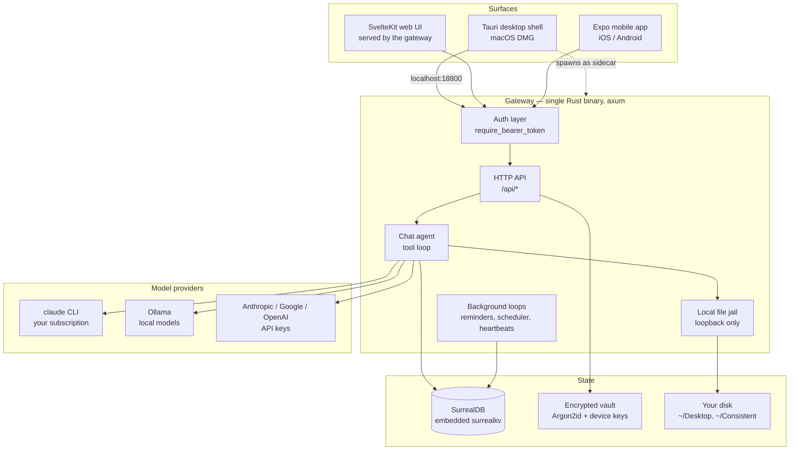
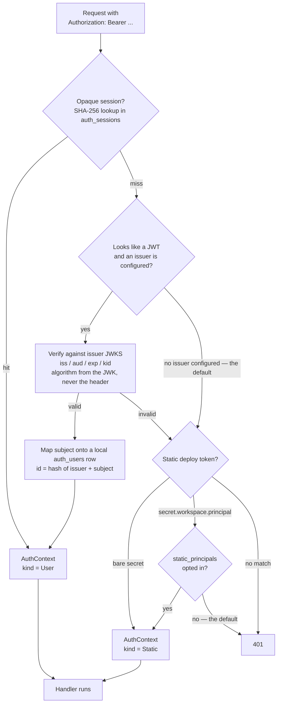
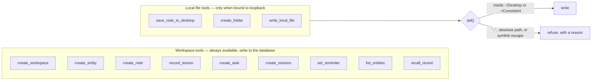
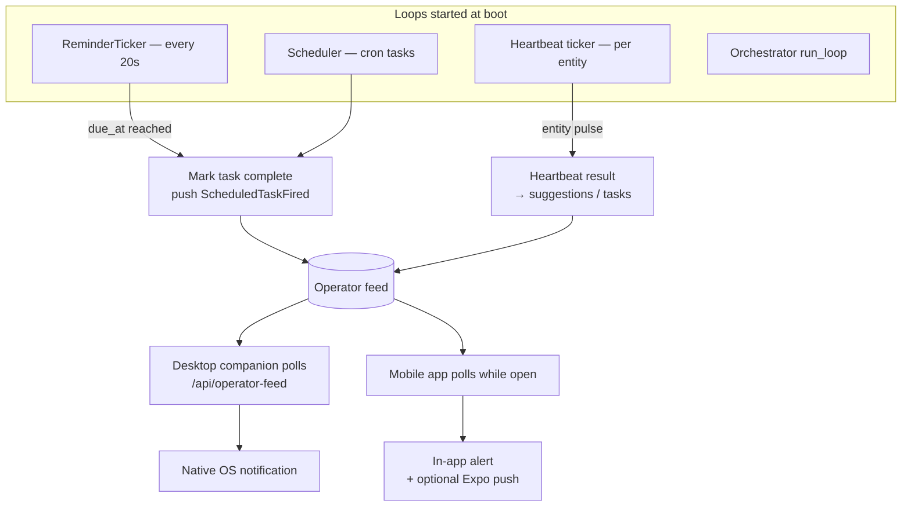
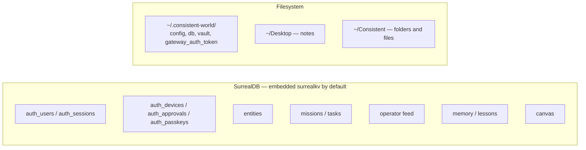
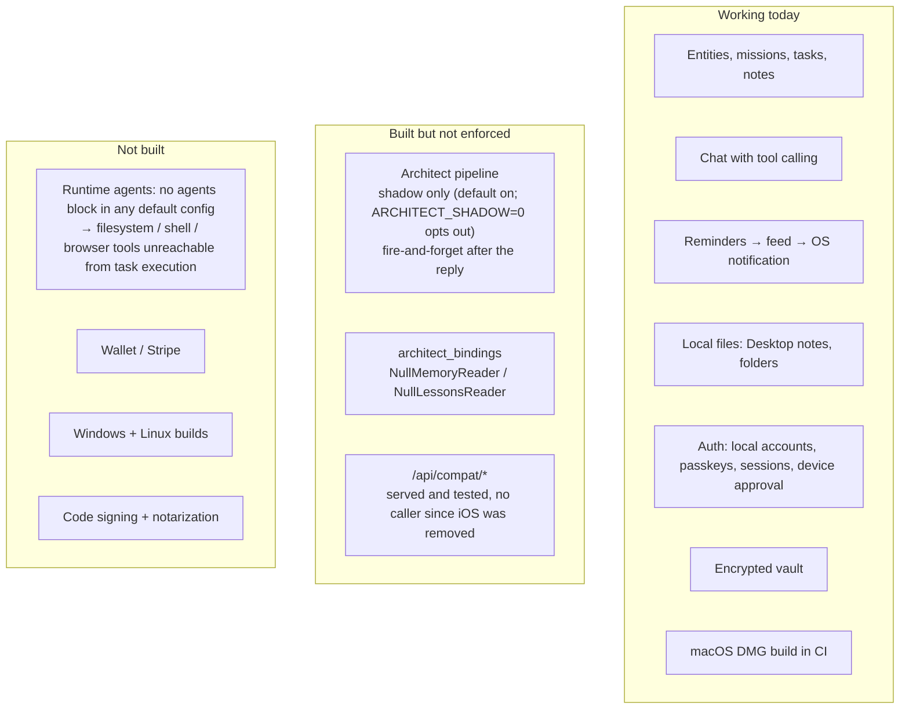
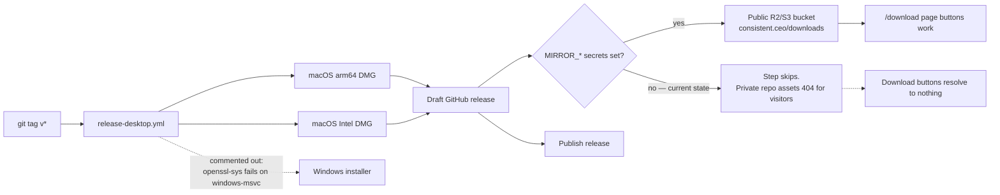

# Consistent CEO — Technical Flow (current state)

> **Scope:** what is actually wired **today**, verified against the source, not
> the target architecture. Where something is designed but not enforced, it is
> drawn as a dashed line and called out. `docs/diagrams/consistent-world-future-state.v2.mmd`
> is the destination; this file is the position.
>
> Last verified: 2026-08-11, branch `feat/on-device-dictation`.

---

## 1. System at a glance

Three surfaces, one Rust binary, one embedded database. The gateway *is* the
product; every client is a view onto it.



**Note the sidecar edge.** The desktop app ships the gateway inside the DMG and
launches it. There is no server to install and nothing to sign up for.

---

## 2. Authentication — three branches, in this order

`server.rs::require_bearer_token`. Order matters and is not arbitrary: the
static branch returns an open `anonymous` context when no token is configured,
so anything placed after it would never be reached.



| Branch | Enabled by default | What it means |
|---|---|---|
| Opaque session | ✅ always | A real person, or their API key |
| External JWT | ❌ off | Only when `[gateway.auth.external] issuer` is set |
| Static token | ✅ loopback | "Whoever holds this machine" — the desktop sidecar |

`PrincipalKind` exists so a handler can tell a signed-in person from the holder
of a deploy secret. `/api/auth/local-session` is the one endpoint that requires
`Static`, and it also requires a loopback bind.

---

## 3. First run and sign-in

Two paths. The first is what almost everyone gets.

```mermaid
sequenceDiagram
    autonumber
    participant U as You
    participant App as Desktop shell
    participant GW as Gateway
    participant Br as System browser

    Note over U,GW: Path A — first run, no forms
    U->>App: double-click
    App->>GW: spawn sidecar, wait for /health
    App->>GW: POST /api/auth/local-session<br/>Bearer &lt;machine token&gt;
    GW->>GW: check kind = Static AND loopback bind
    GW-->>App: real session token
    App->>U: workspace opens

    Note over U,Br: Path B — sign in from a browser, or add a device
    App->>GW: POST /api/auth/approval/start<br/>+ PKCE challenge
    GW-->>App: request_id + 6-digit code
    App->>Br: open /login?approval=&lt;id&gt;
    U->>Br: sign in, type the 6 digits
    Br->>GW: POST /approvals/{id}/approve {code}
    App->>GW: poll /approval/{id}?verifier=...
    GW-->>App: session token
```

The PKCE verifier never leaves the Tauri process — the webview never sees it.
The request id travels through a URL, so it is not treated as a secret.

---

## 4. A chat turn, end to end

```mermaid
sequenceDiagram
    autonumber
    participant U as You
    participant API as POST /api/capture/chat
    participant CA as chat_agent::run_chat_turn
    participant LLM as Model provider
    participant T as Tools
    participant DB as SurrealDB
    participant FS as Your disk

    U->>API: message
    API->>CA: with AuthContext + workspace + entity
    CA->>CA: build_workspace_tools()
    CA->>LLM: prompt + tool schemas
    LLM-->>CA: tool call, e.g. save_note_to_desktop
    CA->>T: execute
    alt workspace tool
        T->>DB: create entity / task / mission / note / reminder
    else local file tool — loopback only
        T->>FS: write inside the jail, or refuse
    end
    T-->>CA: result JSON
    CA->>LLM: tool result
    LLM-->>CA: final reply
    CA-->>U: reply + ChatAction effects
    CA--)DB: Architect shadow run (default on; ARCHITECT_SHADOW=0 opts out)
```

### The twelve tools



On a network-bound gateway the file tools are **absent from the tool list
entirely**, not present-and-refusing — "your Desktop" would be a server's disk.

---

## 5. Background loops

Nothing here needs a browser open. This is what makes it a companion rather
than a chat window.



Every entity gets a default heartbeat on creation — no entity without a pulse.

---

## 6. Where state lives



---

## 7. What is wired vs. what is not

This is the section to read before planning.



### The three that matter most

1. **The evidence promise is not enforced.** `VISION.md` says every consequential
   claim must resolve to a cite, via the Architect's Verify stage. Today the
   Architect runs *after* the reply is produced, fire-and-forget, in shadow mode
   (default on; `ARCHITECT_SHADOW=0` opts out), and writes to `audit_trail`.
   Nothing the user sees is gated by it. This is Milestone 2 and it is the gap
   between the product's stated category and its behaviour.

2. **No runtime agent exists on a fresh install.** `FileSystemTool`, `ShellTool`,
   `BrowserTool` and the coding-agent tool are registered per `[[agents]]` entry,
   and no shipped config defines one — so the loop at `main.rs:371` never
   executes. The new chat file tools are deliberately independent of this, which
   is why "make me a folder" works while task execution still has no hands.

3. **Nobody outside can install it.** Unsigned DMG plus a private repo whose
   release assets 404 anonymously. Both are configuration, not code.

---

## 8. Shipping pipeline



⚠️ The `/download` page advertises a **Windows** installer that CI does not
build. That link is dead today — fix the build or remove the button.

---

## 9. Risks worth tracking

| Risk | Why it matters | Where |
|---|---|---|
| Architect not enforcing | The core product claim is unverified in practice | `chat_agent.rs:628` |
| No default runtime agent | Task execution cannot touch files or shell | `main.rs:371` |
| Model absent on first run | Needs `claude` CLI or Ollama; neither ships in the DMG | `DEFAULT_CONFIG` |
| Unsigned builds | Gatekeeper blocks; most users stop there | `release-desktop.yml` |
| `localhost` vs `127.0.0.1` | Passkeys are origin-bound; the app now uses `localhost` throughout, relying on the browser's `::1` → IPv4 fallback | `login.rs` |
| Compat layer with no caller | Dead surface that still costs maintenance | `/api/compat/*` |
