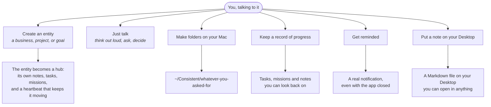
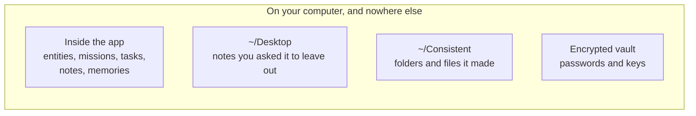
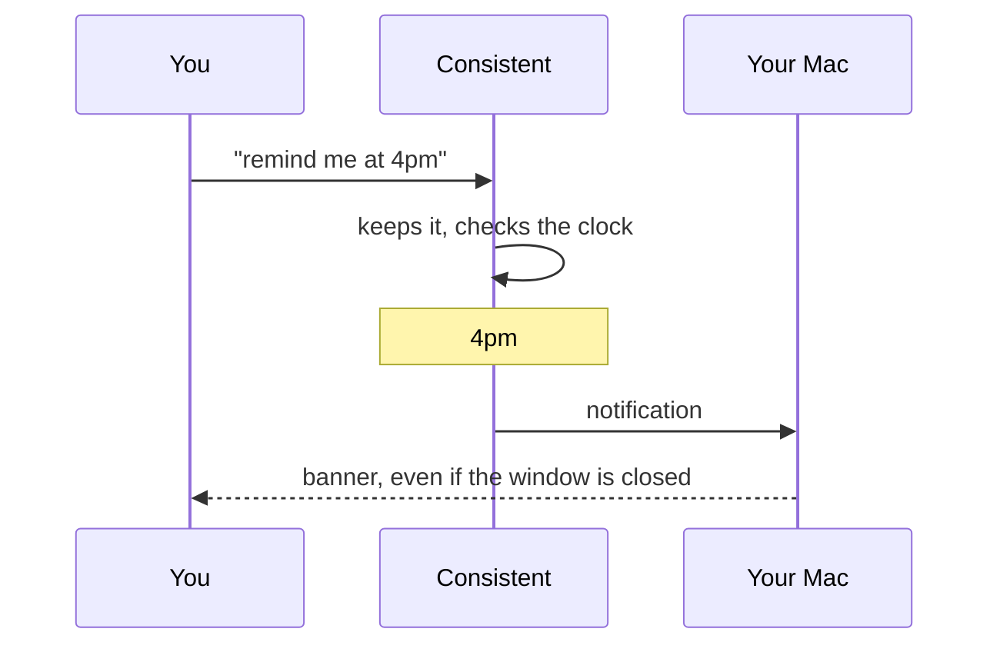
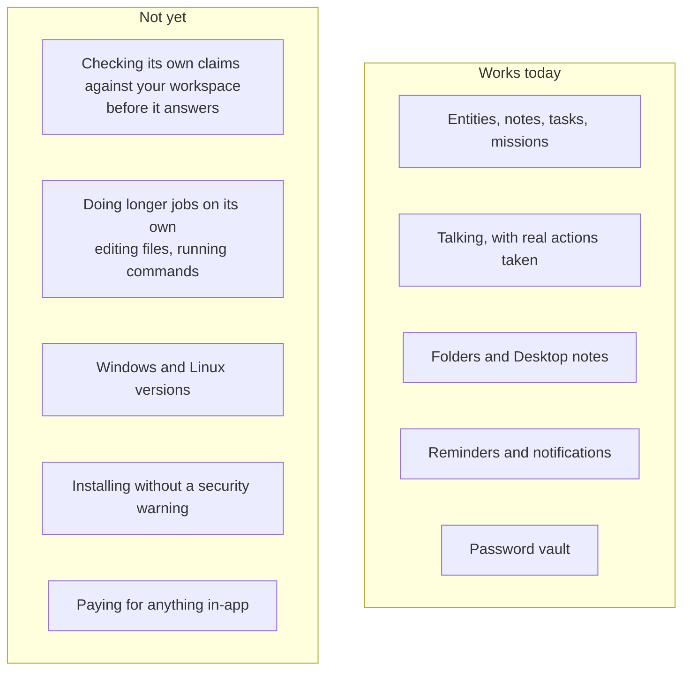
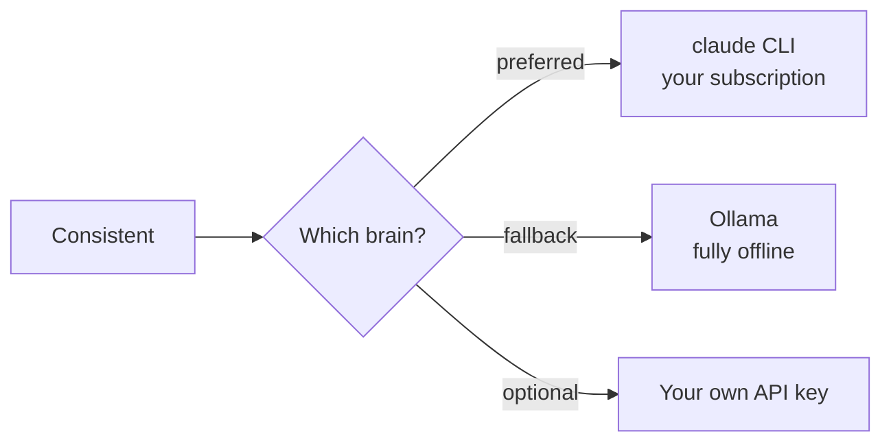
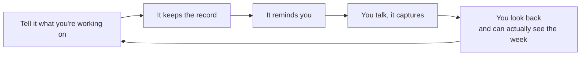

# Consistent CEO — How it works, for the person using it

> Plain language. No setup steps, no code. If you want the engineering view,
> read [`technical-flow.md`](technical-flow.md).
>
> Everything below describes what the app does **today**. Things that are not
> built yet are in their own section at the end, marked clearly, so nobody is
> promised something that isn't there.

---

## What it is, in one line

A private assistant that lives on your own computer, remembers your businesses
and projects, and quietly pushes them forward — instead of forgetting
everything the moment you close the window.

**Your data never leaves your machine.** There is no account to create with us,
no server holding your notes, and it works on a plane.

---

## The first minute

You are signed in because you are sitting at your own computer. There is no
form, no password to invent, no email to confirm.

Later, if you want the phone app or another browser to reach the same
workspace, **Settings → Your account** turns it into a proper account with a
username and password. It's the same account, so everything you've already done
comes with it.

---

## The six things you can do right now

### What each one feels like

| You say | What happens |
|---|---|
| *"Set up an entity for my kitchen business"* | It creates the hub, seeds its profile from what you told it, and gives it a heartbeat |
| *"Remind me to chase the invoice at 4pm"* | At 4pm your Mac shows a notification — the app doesn't need to be open |
| *"Make me a folder for the Acme job"* | `~/Consistent/acme` appears |
| *"Put a note on my desktop with the three things I decided"* | A `.md` file lands on your Desktop |
| *"What was I working on?"* | It recalls recent work, notes and lessons |

---

## Where your things are kept

Two folders are the **only** places the assistant can write, and it cannot be
persuaded otherwise — not by you, and not by anything it reads on the web. If
it tries to write anywhere else, the attempt is refused rather than obeyed.

You can move those two folders in settings. You cannot widen them to your whole
computer, on purpose.

---

## How reminders reach you

The phone app shows the same things while it's open, and can approve a sign-in
on your laptop.

---

## What it does *not* do yet

Being straight about this, because the gap between the pitch and the product is
where trust goes to die.

The honest headlines:

- **It can be confident and wrong.** The design calls for every meaningful claim
  to be checked against your actual workspace before you see it. That checking
  exists but is not switched on yet, so treat what it tells you the way you'd
  treat a sharp colleague talking from memory.
- **It talks and records; it doesn't yet go away and *do* long jobs.** It can
  create a folder or leave a note on request. It cannot yet be handed a
  multi-step job and left alone with it.
- **macOS only for now**, and until the app is signed, macOS will warn you when
  you open it.

---

## It needs a brain

The assistant does the thinking through a model. On your machine that is the
`claude` command-line tool, using your existing Claude subscription — no API
keys, no per-message billing from us.

If none of those is installed, the app runs but has nothing to think with — the
notes, tasks and reminders still work, but conversation won't.

---

## The shape of a week

That loop — say it, keep it, be reminded, look back — is the whole product. Everything
else is in service of it.
